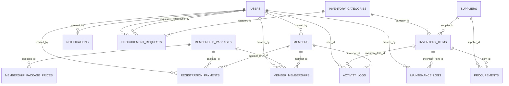

# DOKUMENTASI TABEL DATABASE — SI Inventaris Fitness Center

> **Judul TA**: Sistem Informasi Pengelolaan Inventaris Alat Fitness Pada Fitness Center Vicca Sera Polimak Berbasis Web
>
> **Peneliti**: Welmina — Program Studi Sistem Informasi
>
> **Database**: MySQL — `welmina`

---

## Diagram Relasi Antar Tabel

---

## 1. `users` — Tabel Pengguna Sistem

**Fungsi**: Menyimpan data akun pengguna yang dapat masuk ke sistem. Setiap pengguna memiliki **role** yang menentukan hak akses — `administrator` memiliki akses penuh ke seluruh modul, `pengelola` dapat melihat data inventaris dan mencetak laporan, sedangkan `pimpinan` hanya dapat melihat dashboard ringkasan dan mencetak laporan.

| Nama Atribut | Tipe | Ukuran | Keterangan |
|---|---|---|---|
| `id` | BIGINT (PK) | Auto | Primary key, auto increment |
| `full_name` | VARCHAR | 100 | Nama lengkap pengguna |
| `username` | VARCHAR | 50 | Unique — digunakan sebagai identitas login |
| `email` | VARCHAR | 100 | Nullable, unique — alamat email pengguna |
| `password_hash` | VARCHAR | 255 | Password ter-hash (bcrypt) |
| `role` | VARCHAR | 20 | `administrator` / `pengelola` / `pimpinan` — menentukan hak akses, default `admin` |
| `is_active` | BOOLEAN | - | Status aktif akun, default `true` |
| `remember_token` | VARCHAR | 100 | Nullable — token untuk fitur "Ingat saya" |
| `created_at` | TIMESTAMP | Auto | Waktu pembuatan akun |
| `updated_at` | TIMESTAMP | Auto | Waktu update terakhir |

**Peran dalam sistem**: Tabel ini menjadi pusat autentikasi dan otorisasi. Setelah login berhasil, sistem membuat session dan mengarahkan pengguna ke dashboard sesuai perannya — `administrator` ke `/admin/dashboard`, `pengelola` ke `/pengelola/dashboard`, `pimpinan` ke `/pimpinan/dashboard`. Administrator dapat membuat, mengedit, dan menghapus akun pengguna melalui modul `/admin/user`. Kolom `is_active` dapat digunakan untuk menonaktifkan akun tanpa menghapusnya.

---

## 2. `inventory_categories` — Kategori Inventaris

**Fungsi**: Menyimpan data master kategori barang inventaris fitness center. Kategori digunakan untuk mengelompokkan barang berdasarkan jenisnya, misalnya "Alat Cardio", "Alat Beban", "Perlengkapan", dan lain-lain. Kolom `is_fitness_tools` membedakan kategori alat fitness dari kategori barang pendukung lainnya.

| Nama Atribut | Tipe | Ukuran | Keterangan |
|---|---|---|---|
| `id` | BIGINT (PK) | Auto | Primary key, auto increment |
| `category_name` | VARCHAR | 100 | Unique — nama kategori inventaris |
| `description` | TEXT | - | Nullable — deskripsi tentang kategori |
| `is_fitness_tools` | BOOLEAN | - | Penanda apakah kategori ini termasuk alat fitness, default `false` |
| `created_at` | TIMESTAMP | Auto | Waktu pembuatan data |
| `updated_at` | TIMESTAMP | Auto | Waktu update terakhir |

**Peran dalam sistem**: Tabel ini menjadi referensi pengelompokan pada tabel `inventory_items`. Di halaman dashboard, distribusi kategori ditampilkan sebagai ringkasan jumlah barang per kategori. Administrator dapat mengelola kategori melalui modul `/admin/category`. Penghapusan kategori dicegah (restrict) jika masih ada barang inventaris yang menggunakan kategori tersebut.

---

## 3. `membership_packages` — Paket Keanggotaan

**Fungsi**: Menyimpan data master paket keanggotaan gym yang tersedia. Setiap paket memiliki nama, biaya pendaftaran, dan status aktif. Paket ini menjadi dasar saat mendaftarkan member baru dan saat mencatat pembayaran iuran.

| Nama Atribut | Tipe | Ukuran | Keterangan |
|---|---|---|---|
| `id` | BIGINT (PK) | Auto | Primary key, auto increment |
| `package_name` | VARCHAR | 50 | Unique — nama paket keanggotaan, contoh: "Regular", "Premium" |
| `registration_fee` | DECIMAL | 12,2 | Biaya pendaftaran paket (dalam Rupiah), default `0.00` |
| `description` | TEXT | - | Nullable — deskripsi fasilitas paket |
| `is_active` | BOOLEAN | - | Status aktif paket, default `true` |
| `created_at` | TIMESTAMP | Auto | Waktu pembuatan data |
| `updated_at` | TIMESTAMP | Auto | Waktu update terakhir |

**Peran dalam sistem**: Tabel ini digunakan sebagai referensi saat proses pendaftaran member dan pembayaran iuran. Paket yang tidak aktif (`is_active = false`) tidak ditampilkan di dropdown pilihan. Penghapusan paket dicegah (restrict) jika masih ada data membership yang terhubung.

---

## 4. `membership_package_prices` — Harga Paket per Durasi

**Fungsi**: Menyimpan daftar harga paket keanggotaan berdasarkan durasi (dalam bulan). Satu paket dapat memiliki beberapa pilihan durasi dengan harga yang berbeda, misalnya paket "Regular" dengan harga berbeda untuk 1 bulan, 3 bulan, dan 6 bulan.

| Nama Atribut | Tipe | Ukuran | Keterangan |
|---|---|---|---|
| `id` | BIGINT (PK) | Auto | Primary key, auto increment |
| `package_id` | BIGINT (FK) | - | → `membership_packages.id` — paket yang dimaksud |
| `duration_months` | INT | - | Durasi keanggotaan dalam bulan |
| `price` | DECIMAL | 12,2 | Harga iuran untuk durasi tersebut (dalam Rupiah) |
| `created_at` | TIMESTAMP | Auto | Waktu pembuatan data |
| `updated_at` | TIMESTAMP | Auto | Waktu update terakhir |

**Constraint**: Kombinasi `package_id` + `duration_months` bersifat unique — satu paket tidak boleh memiliki dua harga untuk durasi yang sama.

**Peran dalam sistem**: Saat administrator mencatat pembayaran iuran member, sistem menampilkan pilihan durasi dan harga berdasarkan tabel ini. Harga otomatis terisi saat durasi dipilih. Penghapusan paket induk akan menghapus seluruh data harga terkait (cascade).

---

## 5. `members` — Data Member Fitness Center

**Fungsi**: Menyimpan data anggota/member fitness center. Setiap member memiliki kode unik yang di-generate otomatis, data pribadi, dan status keanggotaan.

| Nama Atribut | Tipe | Ukuran | Keterangan |
|---|---|---|---|
| `id` | BIGINT (PK) | Auto | Primary key, auto increment |
| `member_code` | VARCHAR | 30 | Unique — kode member yang di-generate otomatis |
| `full_name` | VARCHAR | 100 | Nama lengkap member |
| `identity_no` | VARCHAR | 30 | Nullable, unique — nomor identitas (KTP/SIM) |
| `gender` | VARCHAR | 2 | Nullable — jenis kelamin: `L` (Laki-laki) / `P` (Perempuan) |
| `birth_date` | DATE | - | Nullable — tanggal lahir member |
| `phone` | VARCHAR | 20 | Nullable — nomor telepon |
| `email` | VARCHAR | 100 | Nullable — alamat email |
| `address` | TEXT | - | Nullable — alamat lengkap |
| `member_status` | VARCHAR | 20 | Status keanggotaan: `active` / `expired` / `inactive`, default `active` |
| `joined_at` | DATETIME | - | Tanggal bergabung, default waktu saat ini |
| `created_by` | BIGINT (FK) | - | Nullable → `users.id` — admin yang mendaftarkan |
| `created_at` | TIMESTAMP | Auto | Waktu pembuatan data |
| `updated_at` | TIMESTAMP | Auto | Waktu update terakhir |

**Index**: `member_status`

**Peran dalam sistem**: Tabel ini menjadi pusat data keanggotaan yang dihubungkan oleh tabel pembayaran pendaftaran, iuran membership, dan riwayat aktivitas. Administrator mengelola data member melalui modul `/admin/member`. Status member berubah menjadi `expired` saat seluruh membership aktifnya habis masa berlaku. Di laporan harian, jumlah member baru dihitung dari data pendaftaran pada tanggal yang dipilih.

---

## 6. `suppliers` — Data Pemasok/Supplier

**Fungsi**: Menyimpan data supplier/pemasok yang menyediakan barang inventaris untuk fitness center. Data supplier digunakan sebagai referensi saat pencatatan inventaris dan pengadaan barang.

| Nama Atribut | Tipe | Ukuran | Keterangan |
|---|---|---|---|
| `id` | BIGINT (PK) | Auto | Primary key, auto increment |
| `supplier_name` | VARCHAR | 100 | Nama supplier/pemasok |
| `phone` | VARCHAR | 20 | Nullable — nomor telepon |
| `email` | VARCHAR | 100 | Nullable — alamat email |
| `address` | TEXT | - | Nullable — alamat lengkap |
| `notes` | TEXT | - | Nullable — catatan tambahan |
| `created_at` | TIMESTAMP | Auto | Waktu pembuatan data |
| `updated_at` | TIMESTAMP | Auto | Waktu update terakhir |

**Peran dalam sistem**: Tabel ini menjadi referensi pada tabel `inventory_items` dan `procurements`. Saat menambah barang inventaris, administrator dapat memilih supplier asal barang. Penghapusan supplier dicegah (restrict) jika masih ada data pengadaan yang terhubung. Administrator mengelola data pemasok melalui modul `/admin/supplier`.

---

## 7. `inventory_items` — Data Inventaris Barang

**Fungsi**: Menyimpan data utama inventaris barang fitness center. Setiap barang memiliki kode unik, informasi kategori, kondisi fisik, status, lokasi penyimpanan, dan supplier asal. Tabel ini merupakan tabel inti dari sistem inventaris.

| Nama Atribut | Tipe | Ukuran | Keterangan |
|---|---|---|---|
| `id` | BIGINT (PK) | Auto | Primary key, auto increment |
| `item_code` | VARCHAR | 30 | Unique — kode barang inventaris |
| `item_name` | VARCHAR | 100 | Nama barang |
| `category_id` | BIGINT (FK) | - | → `inventory_categories.id` — kategori barang |
| `stock` | INT | - | Jumlah stok, default `0` |
| `item_condition` | VARCHAR | 20 | Kondisi: `baik` / `perlu_perawatan` / `rusak`, default `baik` |
| `item_status` | VARCHAR | 20 | Status: `aktif` / `tidak_aktif`, default `aktif` |
| `location_name` | VARCHAR | 100 | Nullable — lokasi penyimpanan/penempatan barang |
| `supplier_id` | BIGINT (FK) | - | Nullable → `suppliers.id` — supplier asal barang |
| `last_service_date` | DATE | - | Nullable — tanggal perawatan terakhir |
| `image_path` | VARCHAR | 255 | Nullable — path file gambar barang |
| `notes` | TEXT | - | Nullable — catatan tambahan |
| `created_at` | TIMESTAMP | Auto | Waktu pembuatan data |
| `updated_at` | TIMESTAMP | Auto | Waktu update terakhir |

**Index**: `item_condition`, `item_status`

**Peran dalam sistem**: Tabel ini merupakan inti dari seluruh sistem inventaris. Data dari tabel ini ditampilkan di dashboard (statistik kondisi, tabel terbaru), halaman inventaris (tabel lengkap dengan CRUD), laporan barang (tabel dengan filter kondisi dan export PDF/Excel), dan digunakan sebagai referensi oleh tabel maintenance_logs, activity_logs, dan procurements. Penghapusan barang akan menghapus seluruh log perawatan terkait (cascade) namun dicegah (restrict) jika masih ada data pengadaan yang terhubung.

---

## 8. `registration_payments` — Pembayaran Pendaftaran Member

**Fungsi**: Menyimpan data pembayaran biaya pendaftaran member baru. Setiap kali member mendaftar dengan paket tertentu, biaya pendaftarannya dicatat di tabel ini. Tabel ini terpisah dari iuran bulanan.

| Nama Atribut | Tipe | Ukuran | Keterangan |
|---|---|---|---|
| `id` | BIGINT (PK) | Auto | Primary key, auto increment |
| `member_id` | BIGINT (FK) | - | → `members.id` — member yang membayar |
| `package_id` | BIGINT (FK) | - | → `membership_packages.id` — paket yang dipilih |
| `registration_date` | DATE | - | Tanggal pendaftaran |
| `registration_fee` | DECIMAL | 12,2 | Biaya pendaftaran (dalam Rupiah), default `0.00` |
| `admin_fee` | DECIMAL | 12,2 | Biaya administrasi tambahan (dalam Rupiah), default `0.00` |
| `payment_method` | VARCHAR | 20 | Metode: `cash` / `transfer` / `qris` / `debit` / `credit` / `other`, default `cash` |
| `payment_status` | VARCHAR | 20 | Status: `paid` / `unpaid` / `partial` / `cancelled`, default `unpaid` |
| `notes` | TEXT | - | Nullable — catatan tambahan |
| `created_by` | BIGINT (FK) | - | Nullable → `users.id` — admin yang mencatat |
| `created_at` | TIMESTAMP | Auto | Waktu pembuatan data |
| `updated_at` | TIMESTAMP | Auto | Waktu update terakhir |

**Index**: `registration_date`, `payment_status`

**Peran dalam sistem**: Data pembayaran pendaftaran digunakan dalam laporan keuangan sebagai komponen pemasukan. Di laporan harian, tabel "Pendaftaran Member" menampilkan data dari tabel ini yang sesuai dengan tanggal yang dipilih. Administrator mengelola data melalui modul `/admin/registration-payment`.

---

## 9. `member_memberships` — Data Iuran/Biaya Gym

**Fungsi**: Menyimpan data langganan/keanggotaan aktif member beserta pembayaran iurannya. Setiap baris merepresentasikan satu periode membership yang diambil oleh member — mencakup durasi, tanggal mulai dan berakhir, jumlah pembayaran, serta status.

| Nama Atribut | Tipe | Ukuran | Keterangan |
|---|---|---|---|
| `id` | BIGINT (PK) | Auto | Primary key, auto increment |
| `member_id` | BIGINT (FK) | - | → `members.id` — member pemilik membership |
| `package_id` | BIGINT (FK) | - | → `membership_packages.id` — paket yang diambil |
| `duration_months` | INT | - | Durasi dalam bulan |
| `start_date` | DATE | - | Tanggal mulai berlaku |
| `end_date` | DATE | - | Tanggal berakhir |
| `amount` | DECIMAL | 12,2 | Jumlah iuran yang harus dibayar (dalam Rupiah), default `0.00` |
| `admin_fee` | DECIMAL | 12,2 | Biaya administrasi (dalam Rupiah), default `0.00` |
| `payment_method` | VARCHAR | 20 | Metode pembayaran, default `cash` |
| `payment_status` | VARCHAR | 20 | Status bayar: `unpaid` / `paid` / lainnya, default `unpaid` |
| `due_date` | DATE | - | Nullable — tanggal jatuh tempo pembayaran |
| `paid_at` | DATETIME | - | Nullable — waktu pembayaran dilakukan |
| `status` | VARCHAR | 20 | Status membership: `active` / `expired` / `inactive` / `pending`, default `active` |
| `notes` | TEXT | - | Nullable — catatan tambahan |
| `created_by` | BIGINT (FK) | - | Nullable → `users.id` — admin yang mencatat |
| `created_at` | TIMESTAMP | Auto | Waktu pembuatan data |
| `updated_at` | TIMESTAMP | Auto | Waktu update terakhir |

**Index**: `member_id`, `payment_status`, `due_date`, `status`

**Peran dalam sistem**: Tabel ini mencatat seluruh riwayat keanggotaan member dan menjadi sumber data pemasukan iuran dalam laporan keuangan. Di laporan harian, tabel "Pembayaran Iuran" menampilkan data dari tabel ini pada tanggal yang dipilih. Administrator mengelola data melalui modul `/admin/gym-fee`. Status otomatis berubah menjadi `expired` saat `end_date` terlewati.

---

## 10. `procurement_requests` — Permintaan Pengadaan Barang

**Fungsi**: Menyimpan data permintaan pengadaan barang baru yang memerlukan persetujuan. Permintaan dapat diajukan oleh pengelola atau administrator, kemudian disetujui atau ditolak oleh pihak berwenang.

| Nama Atribut | Tipe | Ukuran | Keterangan |
|---|---|---|---|
| `id` | BIGINT (PK) | Auto | Primary key, auto increment |
| `request_no` | VARCHAR | 30 | Unique — nomor permintaan pengadaan |
| `item_name` | VARCHAR | 100 | Nama barang yang diminta |
| `category_id` | BIGINT (FK) | - | Nullable → `inventory_categories.id` — kategori barang |
| `quantity` | INT | - | Jumlah yang diminta |
| `estimated_price` | DECIMAL | 12,2 | Estimasi harga (dalam Rupiah), default `0.00` |
| `supplier_id` | BIGINT (FK) | - | Nullable → `suppliers.id` — supplier yang direkomendasikan |
| `required_date` | DATE | - | Nullable — tanggal dibutuhkan |
| `description` | TEXT | - | Nullable — deskripsi/alasan pengadaan |
| `request_status` | VARCHAR | 20 | Status: `pending` / `approved` / `rejected`, default `pending` |
| `requested_by` | BIGINT (FK) | - | Nullable → `users.id` — pengguna yang mengajukan |
| `approved_by` | BIGINT (FK) | - | Nullable → `users.id` — pengguna yang menyetujui/menolak |
| `approved_at` | DATETIME | - | Nullable — waktu persetujuan/penolakan |
| `created_at` | TIMESTAMP | Auto | Waktu pembuatan data |
| `updated_at` | TIMESTAMP | Auto | Waktu update terakhir |

**Index**: `request_status`

**Peran dalam sistem**: Tabel ini mendukung alur kerja persetujuan pengadaan barang. Permintaan yang diajukan berstatus `pending` hingga disetujui (`approved`) atau ditolak (`rejected`) oleh administrator. Setelah disetujui, data dapat ditindaklanjuti menjadi pencatatan pengadaan di tabel `procurements`.

---

## 11. `procurements` — Pengadaan Barang

**Fungsi**: Menyimpan data realisasi pengadaan/pembelian barang inventaris yang sudah terlaksana. Setiap baris mencatat barang yang dibeli, jumlah, harga, supplier, dan tanggal pengadaan.

| Nama Atribut | Tipe | Ukuran | Keterangan |
|---|---|---|---|
| `id` | BIGINT (PK) | Auto | Primary key, auto increment |
| `procurement_code` | VARCHAR | 30 | Unique — kode pengadaan |
| `item_id` | BIGINT (FK) | - | → `inventory_items.id` — barang yang diadakan |
| `supplier_id` | BIGINT (FK) | - | → `suppliers.id` — supplier penyedia barang |
| `quantity` | INT | - | Jumlah barang yang diadakan |
| `unit_price` | DECIMAL | 12,2 | Harga satuan (dalam Rupiah) |
| `total_price` | DECIMAL | 12,2 | Total harga (quantity × unit_price, dalam Rupiah) |
| `procurement_date` | DATE | - | Tanggal pengadaan |
| `notes` | TEXT | - | Nullable — catatan tambahan |
| `created_at` | TIMESTAMP | Auto | Waktu pembuatan data |
| `updated_at` | TIMESTAMP | Auto | Waktu update terakhir |

**Index**: `procurement_date`

**Peran dalam sistem**: Data pengadaan menjadi komponen pengeluaran dalam laporan keuangan. Total harga dari seluruh pengadaan dihitung sebagai total pengeluaran. Di laporan harian, tabel "Pengadaan Barang" menampilkan data pengadaan pada tanggal yang dipilih. Administrator mengelola data melalui modul `/admin/procurement`. Penghapusan barang induk atau supplier dicegah (restrict) selama masih ada data pengadaan yang terhubung.

---

## 12. `maintenance_logs` — Log Perawatan Barang

**Fungsi**: Menyimpan riwayat perawatan barang inventaris. Setiap kali suatu barang menjalani servis, perbaikan, atau inspeksi, data perawatan dicatat di tabel ini termasuk biaya, hasil kondisi setelah perawatan, dan pelaksana.

| Nama Atribut | Tipe | Ukuran | Keterangan |
|---|---|---|---|
| `id` | BIGINT (PK) | Auto | Primary key, auto increment |
| `inventory_item_id` | BIGINT (FK) | - | → `inventory_items.id` — barang yang dirawat |
| `maintenance_type` | VARCHAR | 20 | Tipe: `service` / `repair` / `inspection`, default `service` |
| `maintenance_date` | DATE | - | Tanggal perawatan dilakukan |
| `cost` | DECIMAL | 12,2 | Biaya perawatan (dalam Rupiah), default `0.00` |
| `result_condition` | VARCHAR | 20 | Kondisi setelah perawatan: `baik` / `perlu_perawatan` / `rusak`, default `baik` |
| `performed_by` | VARCHAR | 100 | Nullable — nama teknisi/pelaksana perawatan |
| `notes` | TEXT | - | Nullable — catatan tentang perawatan |
| `created_by` | BIGINT (FK) | - | Nullable → `users.id` — admin yang mencatat |
| `created_at` | TIMESTAMP | Auto | Waktu pembuatan data |
| `updated_at` | TIMESTAMP | Auto | Waktu update terakhir |

**Peran dalam sistem**: Data perawatan ditampilkan di dashboard (panel "Perawatan Rutin" menampilkan 5 log terbaru), halaman perawatan barang (tabel lengkap dengan CRUD), dan laporan harian (tabel "Perawatan Barang" pada tanggal terpilih). Biaya perawatan juga dihitung sebagai komponen pengeluaran dalam laporan keuangan. Administrator mengelola data melalui modul `/admin/maintenance-logs`. Penghapusan barang induk akan menghapus seluruh log perawatan terkait (cascade).

---

## 13. `activity_logs` — Riwayat Aktivitas Sistem

**Fungsi**: Menyimpan riwayat seluruh aktivitas yang terjadi dalam sistem secara otomatis. Setiap operasi penting (tambah barang, servis, pendaftaran, pembayaran, dll.) dicatat sebagai satu baris aktivitas untuk keperluan audit trail dan monitoring.

| Nama Atribut | Tipe | Ukuran | Keterangan |
|---|---|---|---|
| `id` | BIGINT (PK) | Auto | Primary key, auto increment |
| `activity_time` | DATETIME | - | Waktu aktivitas terjadi, default waktu saat ini |
| `activity_name` | VARCHAR | 100 | Nama/judul aktivitas |
| `activity_type` | VARCHAR | 20 | Tipe: `tambah` / `servis` / `pinjam` / `kembali` / `rusak` / `pengadaan` / `pembayaran` / `pendaftaran` / `lainnya`, default `lainnya` |
| `inventory_item_id` | BIGINT (FK) | - | Nullable → `inventory_items.id` — barang terkait (jika ada) |
| `member_id` | BIGINT (FK) | - | Nullable → `members.id` — member terkait (jika ada) |
| `user_id` | BIGINT (FK) | - | Nullable → `users.id` — pengguna yang melakukan aktivitas |
| `description` | TEXT | - | Nullable — deskripsi detail aktivitas |
| `reference_table` | VARCHAR | 50 | Nullable — nama tabel sumber referensi |
| `reference_id` | BIGINT | - | Nullable — ID record sumber di tabel referensi |
| `created_at` | TIMESTAMP | Auto | Waktu pembuatan data |
| `updated_at` | TIMESTAMP | Auto | Waktu update terakhir |

**Index**: `activity_time`, `activity_type`

**Peran dalam sistem**: Data aktivitas ditampilkan di dashboard (panel "Aktivitas Terbaru" menampilkan 5 aktivitas terakhir), halaman riwayat aktivitas (tabel lengkap dengan pencarian dan pagination), dan laporan harian (panel "Riwayat Aktivitas" pada tanggal terpilih). Setiap aktivitas ditampilkan dengan lencana berwarna sesuai tipenya. Administrator dapat melihat detail dan menghapus catatan aktivitas melalui modul `/admin/activity-log`.

---

## 14. `notifications` — Notifikasi Sistem

**Fungsi**: Menyimpan notifikasi yang dihasilkan secara otomatis oleh sistem untuk memberi informasi kepada administrator tentang kejadian penting, seperti barang rusak, membership expired, stok menipis, dan lain-lain.

| Nama Atribut | Tipe | Ukuran | Keterangan |
|---|---|---|---|
| `id` | BIGINT (PK) | Auto | Primary key, auto increment |
| `title` | VARCHAR | 150 | Judul notifikasi |
| `message` | TEXT | - | Isi pesan notifikasi |
| `notification_type` | VARCHAR | 20 | Tipe: `info` / `warning` / `danger` / `success`, default `info` |
| `is_read` | BOOLEAN | - | Status sudah dibaca, default `false` |
| `related_table` | VARCHAR | 50 | Nullable — nama tabel sumber yang memicu notifikasi |
| `related_id` | BIGINT | - | Nullable — ID record sumber di tabel terkait |
| `created_by` | BIGINT (FK) | - | Nullable → `users.id` — pengguna/sistem yang membuat |
| `created_at` | TIMESTAMP | Auto | Waktu pembuatan notifikasi |
| `updated_at` | TIMESTAMP | Auto | Waktu update terakhir |

**Peran dalam sistem**: Jumlah notifikasi yang belum dibaca (`is_read = false`) ditampilkan sebagai lencana angka di menu notifikasi pada bilah samping. Administrator dapat melihat seluruh notifikasi, menandai semua sebagai telah dibaca, dan menghapus notifikasi melalui modul `/admin/notification`.

---

## Enum dan Nilai Konstan

### Role Pengguna

| Nilai | Keterangan |
|---|---|
| `administrator` | Akses penuh: kelola seluruh modul (member, inventaris, transaksi, laporan, pengguna, pengaturan) |
| `pengelola` | Akses terbatas: lihat inventaris, perawatan, pemasok, dan cetak laporan (read-only) |
| `pimpinan` | Akses minimal: lihat dashboard ringkasan dan cetak laporan |

### Kondisi Barang (`item_condition`)

| Nilai | Keterangan |
|---|---|
| `baik` | Barang dalam kondisi baik dan layak pakai |
| `perlu_perawatan` | Barang memerlukan perawatan/servis |
| `rusak` | Barang rusak, tidak layak pakai, perlu diganti |

### Status Barang (`item_status`)

| Nilai | Keterangan |
|---|---|
| `aktif` | Barang aktif digunakan |
| `tidak_aktif` | Barang tidak aktif/ditarik dari penggunaan |

### Status Member (`member_status`)

| Nilai | Keterangan |
|---|---|
| `active` | Member aktif dengan membership berlaku |
| `expired` | Membership telah habis masa berlaku |
| `inactive` | Member dinonaktifkan secara manual |

### Tipe Perawatan (`maintenance_type`)

| Nilai | Keterangan |
|---|---|
| `service` | Perawatan rutin/servis berkala |
| `repair` | Perbaikan kerusakan |
| `inspection` | Pemeriksaan/inspeksi kondisi |

### Status Pembayaran (`payment_status`)

| Nilai | Keterangan |
|---|---|
| `paid` | Telah dibayar lunas |
| `unpaid` | Belum dibayar |
| `partial` | Dibayar sebagian |
| `cancelled` | Dibatalkan |

### Tipe Aktivitas (`activity_type`)

| Nilai | Keterangan |
|---|---|
| `tambah` | Penambahan barang baru |
| `servis` | Perawatan/servis barang |
| `pinjam` | Peminjaman barang |
| `kembali` | Pengembalian barang |
| `rusak` | Pelaporan kerusakan |
| `pengadaan` | Pengadaan barang baru |
| `pembayaran` | Pembayaran iuran/biaya |
| `pendaftaran` | Pendaftaran member baru |
| `lainnya` | Aktivitas lain yang tidak terklasifikasi |

### Tipe Notifikasi (`notification_type`)

| Nilai | Keterangan |
|---|---|
| `info` | Informasi umum |
| `warning` | Peringatan (stok menipis, akan expired) |
| `danger` | Penting/darurat (barang rusak, overdue) |
| `success` | Konfirmasi keberhasilan |

### Metode Pembayaran (`payment_method`)

| Nilai | Keterangan |
|---|---|
| `cash` | Tunai |
| `transfer` | Transfer bank |
| `qris` | QRIS (Quick Response Code Indonesian Standard) |
| `debit` | Kartu debit |
| `credit` | Kartu kredit |
| `other` | Metode lainnya |

---

## Tabel Sistem (Laravel Framework)

Tabel-tabel berikut dibuat secara otomatis oleh framework Laravel dan digunakan untuk keperluan internal sistem:

| Tabel | Fungsi |
|---|---|
| `sessions` | Menyimpan data session pengguna yang sedang login |
| `password_reset_tokens` | Menyimpan token untuk reset password |
| `cache` | Menyimpan data cache aplikasi |
| `cache_locks` | Menyimpan lock untuk operasi cache |
| `jobs` | Antrian pekerjaan background (queue) |
| `job_batches` | Data batch pekerjaan |
| `failed_jobs` | Catatan pekerjaan yang gagal dieksekusi |

---

## Penjelasan Alur Sistem

1. **Administrator menyiapkan master data**: kategori inventaris → paket keanggotaan → harga paket per durasi → supplier
2. **Administrator mendaftarkan member**: input data member → pilih paket → catat pembayaran pendaftaran
3. **Administrator mencatat iuran**: pilih member → pilih paket & durasi → set tanggal mulai/berakhir → catat pembayaran
4. **Administrator mengelola inventaris**: tambah barang → assign kategori & supplier → update kondisi → catat perawatan
5. **Administrator melakukan pengadaan**: buat pengadaan → pilih barang & supplier → catat jumlah & harga
6. **Sistem mencatat aktivitas**: setiap operasi CRUD otomatis menghasilkan log aktivitas dan notifikasi terkait
7. **Pengelola memantau**: melihat data inventaris, peralatan, perawatan, supplier (read-only) → cetak laporan
8. **Pimpinan mengawasi**: melihat dashboard ringkasan → cetak laporan barang, keuangan, dan harian
