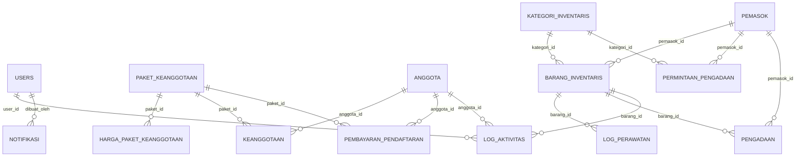

# 📊 DOKUMENTASI TABEL DATABASE — SI Manajemen Gym Welmina Fitness

> **Judul TA**: Sistem Informasi Manajemen Gym Welmina Fitness
>
> **Peneliti**: — Program Studi Sistem Informasi
>
> **Database**: MySQL — `welmina`

---

## Diagram Relasi Antar Tabel

---

## 1. `users` — Tabel Pengguna Sistem

**Fungsi**: Menyimpan data akun pengguna yang dapat masuk ke sistem. Setiap pengguna memiliki **peran** yang menentukan hak akses — `admin` mengelola data master dan operasional, `pengelola` menangani operasional harian, dan `pimpinan` memantau laporan.

| Nama Atribut | Tipe | Ukuran | Keterangan |
|---|---|---|---|
| `id` | BIGINT (PK) | Auto | Primary key, auto increment |
| `nama_lengkap` | VARCHAR | 100 | Nama lengkap pengguna |
| `username` | VARCHAR | 50 | Unique — digunakan sebagai identitas login |
| `email` | VARCHAR | 100 | Nullable, unique — email pengguna |
| `password_hash` | VARCHAR | 255 | Password ter-hash (bcrypt) |
| `peran` | VARCHAR | 20 | `admin` / `pengelola` / `pimpinan` — default `admin` |
| `aktif` | BOOLEAN | - | Status aktif akun, default `true` |
| `remember_token` | VARCHAR | 100 | Token untuk fitur "remember me" |
| `created_at` | TIMESTAMP | Auto | Waktu pembuatan akun |
| `updated_at` | TIMESTAMP | Auto | Waktu update terakhir |

**Peran dalam sistem**: Tabel ini menjadi pusat autentikasi dan otorisasi. Setelah login, sistem mengarahkan pengguna berdasarkan peran — `admin` ke panel manajemen penuh, `pengelola` ke modul operasional (anggota, inventaris, pembayaran), dan `pimpinan` ke dashboard laporan. Tabel ini juga menjadi referensi untuk pencatatan aktivitas dan notifikasi.

---

## 2. `paket_keanggotaan` — Master Data Paket Membership

**Fungsi**: Menyimpan data master paket keanggotaan gym yang tersedia. Setiap paket memiliki nama, biaya pendaftaran, dan status aktif. Harga per durasi disimpan terpisah di tabel `harga_paket_keanggotaan`.

| Nama Atribut | Tipe | Ukuran | Keterangan |
|---|---|---|---|
| `id` | BIGINT (PK) | Auto | Primary key, auto increment |
| `nama_paket` | VARCHAR | 50 | Unique — nama paket, contoh: `Regular`, `VIP`, `Premium` |
| `biaya_pendaftaran` | DECIMAL | 12,2 | Biaya pendaftaran awal (Rupiah), default 0.00 |
| `deskripsi` | TEXT | - | Nullable — deskripsi fasilitas paket |
| `aktif` | BOOLEAN | - | Status ketersediaan paket, default `true` |
| `created_at` | TIMESTAMP | Auto | Waktu pembuatan data |
| `updated_at` | TIMESTAMP | Auto | Waktu update terakhir |

**Peran dalam sistem**: Tabel ini menjadi referensi utama saat pendaftaran anggota baru dan perpanjangan membership. Paket yang tidak aktif (`aktif = false`) tidak ditampilkan di form pendaftaran. Admin mengelola paket melalui modul manajemen paket keanggotaan.

---

## 3. `harga_paket_keanggotaan` — Harga Paket per Durasi

**Fungsi**: Menyimpan variasi harga paket berdasarkan durasi (dalam bulan). Satu paket bisa memiliki beberapa opsi durasi dengan harga berbeda — misalnya paket Regular: 1 bulan Rp150.000, 3 bulan Rp400.000, 6 bulan Rp700.000.

| Nama Atribut | Tipe | Ukuran | Keterangan |
|---|---|---|---|
| `id` | BIGINT (PK) | Auto | Primary key, auto increment |
| `paket_id` | BIGINT (FK) | - | → `paket_keanggotaan.id` — paket yang dimaksud |
| `durasi_bulan` | INT | - | Jumlah bulan durasi keanggotaan |
| `harga` | DECIMAL | 12,2 | Harga untuk durasi tersebut (Rupiah) |
| `created_at` | TIMESTAMP | Auto | Waktu pembuatan data |
| `updated_at` | TIMESTAMP | Auto | Waktu update terakhir |

**Constraint**: Kombinasi `(paket_id, durasi_bulan)` bersifat unique — satu paket hanya boleh punya satu harga per durasi.

**Peran dalam sistem**: Saat anggota memilih paket dan durasi di form pendaftaran atau perpanjangan, sistem mengambil harga dari tabel ini untuk menghitung total pembayaran. Admin dapat mengelola variasi harga per paket tanpa mengubah data paket utama.

---

## 4. `anggota` — Data Member Gym

**Fungsi**: Menyimpan data pribadi anggota gym Welmina Fitness. Setiap anggota memiliki kode unik yang di-generate otomatis dan status keanggotaan yang diperbarui secara berkala.

| Nama Atribut | Tipe | Ukuran | Keterangan |
|---|---|---|---|
| `id` | BIGINT (PK) | Auto | Primary key, auto increment |
| `kode_anggota` | VARCHAR | 30 | Unique — kode member yang di-generate, contoh: `WLM-2026-0001` |
| `nama_lengkap` | VARCHAR | 100 | Nama lengkap anggota |
| `no_identitas` | VARCHAR | 30 | Nullable, unique — nomor KTP/SIM |
| `jenis_kelamin` | VARCHAR | 2 | Nullable — `L` (Laki-laki) / `P` (Perempuan) |
| `tanggal_lahir` | DATE | - | Nullable — tanggal lahir |
| `telepon` | VARCHAR | 20 | Nullable — nomor telepon/WhatsApp |
| `email` | VARCHAR | 100 | Nullable — alamat email |
| `alamat` | TEXT | - | Nullable — alamat domisili |
| `status_anggota` | VARCHAR | 20 | `active` / `expired` / `inactive` — default `active` |
| `bergabung_pada` | DATETIME | Auto | Tanggal pertama kali bergabung |
| `created_at` | TIMESTAMP | Auto | Waktu pembuatan data |
| `updated_at` | TIMESTAMP | Auto | Waktu update terakhir |

**Peran dalam sistem**: Tabel ini menjadi pusat data keanggotaan. Status anggota diperbarui otomatis — menjadi `expired` jika seluruh membership aktifnya sudah melewati tanggal berakhir, atau diubah manual ke `inactive` oleh admin. Data anggota digunakan di modul pendaftaran, perpanjangan, pembayaran, dan laporan.

---

## 5. `keanggotaan` — Riwayat Membership Anggota

**Fungsi**: Menyimpan riwayat keanggotaan (membership) setiap anggota. Satu anggota bisa memiliki beberapa record — setiap perpanjangan atau perubahan paket menghasilkan record baru.

| Nama Atribut | Tipe | Ukuran | Keterangan |
|---|---|---|---|
| `id` | BIGINT (PK) | Auto | Primary key, auto increment |
| `anggota_id` | BIGINT (FK) | - | → `anggota.id` — anggota pemilik membership |
| `paket_id` | BIGINT (FK) | - | → `paket_keanggotaan.id` — paket yang dipilih |
| `durasi_bulan` | INT | - | Durasi membership (bulan) |
| `tanggal_mulai` | DATE | - | Tanggal mulai berlaku |
| `tanggal_berakhir` | DATE | - | Tanggal berakhir membership |
| `jumlah` | DECIMAL | 12,2 | Total biaya membership (Rupiah), default 0.00 |
| `biaya_admin` | DECIMAL | 12,2 | Biaya administrasi tambahan, default 0.00 |
| `metode_pembayaran` | VARCHAR | 20 | `cash` / `transfer` / `qris` / `debit` / `credit` / `other` — default `cash` |
| `status_pembayaran` | VARCHAR | 20 | `paid` / `unpaid` / `partial` / `cancelled` — default `unpaid` |
| `jatuh_tempo` | DATE | - | Nullable — batas waktu pembayaran |
| `dibayar_pada` | DATETIME | - | Nullable — waktu pembayaran lunas |
| `status` | VARCHAR | 20 | `active` / `expired` / `inactive` / `pending` — default `active` |
| `catatan` | TEXT | - | Nullable — catatan tambahan |
| `created_at` | TIMESTAMP | Auto | Waktu pembuatan data |
| `updated_at` | TIMESTAMP | Auto | Waktu update terakhir |

**Peran dalam sistem**: Tabel ini mencatat seluruh siklus hidup membership. Saat anggota mendaftar atau memperpanjang, record baru dibuat dengan status `active`. Sistem secara berkala mengecek `tanggal_berakhir` — membership yang sudah lewat diubah ke `expired`. Modul pembayaran memperbarui `status_pembayaran` dan `dibayar_pada` saat anggota melunasi.

---

## 6. `pembayaran_pendaftaran` — Pembayaran Biaya Pendaftaran

**Fungsi**: Menyimpan data pembayaran biaya pendaftaran awal anggota baru. Terpisah dari pembayaran membership bulanan karena biaya pendaftaran bersifat satu kali (one-time fee) saat pertama mendaftar.

| Nama Atribut | Tipe | Ukuran | Keterangan |
|---|---|---|---|
| `id` | BIGINT (PK) | Auto | Primary key, auto increment |
| `anggota_id` | BIGINT (FK) | - | → `anggota.id` — anggota yang mendaftar |
| `paket_id` | BIGINT (FK) | - | → `paket_keanggotaan.id` — paket yang dipilih |
| `tanggal_pendaftaran` | DATE | - | Tanggal transaksi pendaftaran |
| `biaya_pendaftaran` | DECIMAL | 12,2 | Biaya pendaftaran (Rupiah), default 0.00 |
| `biaya_admin` | DECIMAL | 12,2 | Biaya administrasi, default 0.00 |
| `metode_pembayaran` | VARCHAR | 20 | `cash` / `transfer` / `qris` / `debit` / `credit` / `other` — default `cash` |
| `status_pembayaran` | VARCHAR | 20 | `paid` / `unpaid` / `partial` / `cancelled` — default `unpaid` |
| `catatan` | TEXT | - | Nullable — catatan tambahan |
| `created_at` | TIMESTAMP | Auto | Waktu pembuatan data |
| `updated_at` | TIMESTAMP | Auto | Waktu update terakhir |

**Peran dalam sistem**: Record dibuat otomatis saat admin mendaftarkan anggota baru. Biaya pendaftaran diambil dari `paket_keanggotaan.biaya_pendaftaran`. Tabel ini membantu pelacakan keuangan terpisah antara pendapatan pendaftaran dan pendapatan membership rutin.

---

## 7. `pemasok` — Data Supplier/Vendor

**Fungsi**: Menyimpan data pemasok yang menyuplai peralatan dan kebutuhan gym. Data ini digunakan sebagai referensi saat pengadaan barang baru.

| Nama Atribut | Tipe | Ukuran | Keterangan |
|---|---|---|---|
| `id` | BIGINT (PK) | Auto | Primary key, auto increment |
| `nama_pemasok` | VARCHAR | 100 | Nama perusahaan/toko pemasok |
| `telepon` | VARCHAR | 20 | Nullable — nomor telepon kontak |
| `email` | VARCHAR | 100 | Nullable — email kontak |
| `alamat` | TEXT | - | Nullable — alamat pemasok |
| `catatan` | TEXT | - | Nullable — catatan tambahan |
| `created_at` | TIMESTAMP | Auto | Waktu pembuatan data |
| `updated_at` | TIMESTAMP | Auto | Waktu update terakhir |

**Peran dalam sistem**: Tabel ini menjadi referensi di modul inventaris dan pengadaan. Saat mencatat barang baru atau membuat permintaan pengadaan, pengelola memilih pemasok dari data ini. Admin mengelola data pemasok melalui modul manajemen supplier.

---

## 8. `kategori_inventaris` — Kategori Barang Inventaris

**Fungsi**: Menyimpan kategori pengelompokan barang inventaris gym. Membedakan antara alat fitness (treadmill, dumbbell, dll.) dan barang pendukung (furniture, elektronik, kebersihan).

| Nama Atribut | Tipe | Ukuran | Keterangan |
|---|---|---|---|
| `id` | BIGINT (PK) | Auto | Primary key, auto increment |
| `nama_kategori` | VARCHAR | 100 | Unique — nama kategori, contoh: `Cardio`, `Strength`, `Furniture` |
| `deskripsi` | TEXT | - | Nullable — penjelasan kategori |
| `alat_fitness` | BOOLEAN | - | Penanda apakah kategori ini termasuk alat fitness, default `false` |
| `created_at` | TIMESTAMP | Auto | Waktu pembuatan data |
| `updated_at` | TIMESTAMP | Auto | Waktu update terakhir |

**Peran dalam sistem**: Kategori membantu pengelompokan dan filtering barang inventaris. Flag `alat_fitness` digunakan untuk memisahkan alat gym dari barang pendukung di laporan dan dashboard — misalnya menampilkan khusus "Kondisi Alat Fitness" di dashboard pimpinan.

---

## 9. `barang_inventaris` — Data Barang/Alat Gym

**Fungsi**: Menyimpan data seluruh barang inventaris gym termasuk alat fitness, furniture, dan peralatan pendukung. Setiap barang memiliki kode unik, kondisi, status, dan riwayat perawatan.

| Nama Atribut | Tipe | Ukuran | Keterangan |
|---|---|---|---|
| `id` | BIGINT (PK) | Auto | Primary key, auto increment |
| `pemasok_id` | BIGINT (FK) | - | Nullable → `pemasok.id` — pemasok barang |
| `kategori_id` | BIGINT (FK) | - | → `kategori_inventaris.id` — kategori barang |
| `kode_barang` | VARCHAR | 30 | Unique — kode inventaris, contoh: `INV-TRD-001` |
| `nama_barang` | VARCHAR | 100 | Nama barang, contoh: `Treadmill Technogym Run 1000` |
| `stok` | INT | - | Jumlah stok tersedia, default 0 |
| `kondisi_barang` | VARCHAR | 20 | `baik` / `perlu_perawatan` / `rusak` — default `baik` |
| `status_barang` | VARCHAR | 20 | `aktif` / `tidak_aktif` — default `aktif` |
| `lokasi` | VARCHAR | 100 | Nullable — lokasi penempatan, contoh: `Lantai 2 - Area Cardio` |
| `tanggal_servis_terakhir` | DATE | - | Nullable — tanggal terakhir diservis |
| `path_gambar` | VARCHAR | 255 | Nullable — path foto barang |
| `catatan` | TEXT | - | Nullable — catatan tambahan |
| `created_at` | TIMESTAMP | Auto | Waktu pembuatan data |
| `updated_at` | TIMESTAMP | Auto | Waktu update terakhir |

**Peran dalam sistem**: Tabel ini menjadi pusat modul inventaris. Kondisi barang diperbarui setelah perawatan (dari `log_perawatan`). Barang dengan kondisi `perlu_perawatan` atau `rusak` ditampilkan sebagai peringatan di dashboard. Status `tidak_aktif` menandakan barang sudah tidak digunakan (retired). Pengelola mengelola data barang termasuk upload foto.

---

## 10. `permintaan_pengadaan` — Permintaan Pengadaan Barang

**Fungsi**: Menyimpan data permintaan pengadaan barang baru sebelum disetujui dan direalisasikan. Digunakan sebagai workflow perencanaan pembelian peralatan gym.

| Nama Atribut | Tipe | Ukuran | Keterangan |
|---|---|---|---|
| `id` | BIGINT (PK) | Auto | Primary key, auto increment |
| `pemasok_id` | BIGINT (FK) | - | Nullable → `pemasok.id` — pemasok yang dituju |
| `kategori_id` | BIGINT (FK) | - | Nullable → `kategori_inventaris.id` — kategori barang |
| `no_permintaan` | VARCHAR | 30 | Unique — nomor permintaan, contoh: `REQ-2026-0015` |
| `nama_barang` | VARCHAR | 100 | Nama barang yang diminta |
| `jumlah` | INT | - | Jumlah yang diminta |
| `estimasi_harga` | DECIMAL | 12,2 | Estimasi harga satuan (Rupiah), default 0.00 |
| `tanggal_dibutuhkan` | DATE | - | Nullable — target tanggal barang dibutuhkan |
| `deskripsi` | TEXT | - | Nullable — alasan/justifikasi permintaan |
| `created_at` | TIMESTAMP | Auto | Waktu pembuatan data |
| `updated_at` | TIMESTAMP | Auto | Waktu update terakhir |

**Peran dalam sistem**: Pengelola membuat permintaan pengadaan saat alat perlu diganti atau ditambah. Permintaan ini menjadi dasar untuk proses pengadaan aktual yang tercatat di tabel `pengadaan`. Admin/pimpinan dapat meninjau dan menyetujui permintaan sebelum realisasi pembelian.

---

## 11. `pengadaan` — Realisasi Pengadaan Barang

**Fungsi**: Menyimpan data realisasi pengadaan (pembelian) barang yang sudah terlaksana. Setiap record mencatat barang apa yang dibeli, dari pemasok mana, berapa harganya, dan kapan dibeli.

| Nama Atribut | Tipe | Ukuran | Keterangan |
|---|---|---|---|
| `id` | BIGINT (PK) | Auto | Primary key, auto increment |
| `barang_id` | BIGINT (FK) | - | → `barang_inventaris.id` — barang yang diadakan |
| `pemasok_id` | BIGINT (FK) | - | → `pemasok.id` — pemasok yang menyuplai |
| `kode_pengadaan` | VARCHAR | 30 | Unique — kode transaksi, contoh: `PRC-2026-0008` |
| `jumlah` | INT | - | Jumlah barang yang dibeli |
| `harga_satuan` | DECIMAL | 12,2 | Harga per unit (Rupiah) |
| `harga_total` | DECIMAL | 12,2 | Total biaya (jumlah × harga_satuan) |
| `tanggal_pengadaan` | DATE | - | Tanggal pembelian/pengadaan |
| `catatan` | TEXT | - | Nullable — catatan tambahan |
| `created_at` | TIMESTAMP | Auto | Waktu pembuatan data |
| `updated_at` | TIMESTAMP | Auto | Waktu update terakhir |

**Peran dalam sistem**: Tabel ini mencatat seluruh pengeluaran pengadaan barang untuk keperluan laporan keuangan dan audit. Saat pengadaan dicatat, stok barang di `barang_inventaris` dapat diperbarui. Data ini ditampilkan di laporan pengeluaran untuk pimpinan.

---

## 12. `log_perawatan` — Riwayat Perawatan Alat

**Fungsi**: Menyimpan riwayat perawatan dan perbaikan barang inventaris. Setiap servis, repair, atau inspeksi tercatat di sini beserta biaya dan hasil kondisi setelah perawatan.

| Nama Atribut | Tipe | Ukuran | Keterangan |
|---|---|---|---|
| `id` | BIGINT (PK) | Auto | Primary key, auto increment |
| `barang_id` | BIGINT (FK) | - | → `barang_inventaris.id` — barang yang dirawat |
| `jenis_perawatan` | VARCHAR | 20 | `service` / `repair` / `inspection` — default `service` |
| `tanggal_perawatan` | DATE | - | Tanggal perawatan dilakukan |
| `biaya` | DECIMAL | 12,2 | Biaya perawatan (Rupiah), default 0.00 |
| `kondisi_hasil` | VARCHAR | 20 | `baik` / `perlu_perawatan` / `rusak` — kondisi setelah perawatan, default `baik` |
| `dilakukan_oleh` | VARCHAR | 100 | Nullable — nama teknisi/vendor yang melakukan perawatan |
| `catatan` | TEXT | - | Nullable — detail pekerjaan yang dilakukan |
| `created_at` | TIMESTAMP | Auto | Waktu pembuatan data |
| `updated_at` | TIMESTAMP | Auto | Waktu update terakhir |

**Peran dalam sistem**: Setelah perawatan dicatat, sistem otomatis memperbarui `kondisi_barang` dan `tanggal_servis_terakhir` di tabel `barang_inventaris`. Data ini digunakan untuk tracking jadwal servis berkala dan laporan biaya perawatan. Dashboard menampilkan alat yang sudah lama tidak diservis sebagai reminder.

---

## 13. `log_aktivitas` — Log Aktivitas Sistem

**Fungsi**: Menyimpan catatan seluruh aktivitas penting yang terjadi dalam sistem — pendaftaran anggota, pembayaran, servis alat, pengadaan, dan lainnya. Berfungsi sebagai audit trail dan sumber data untuk laporan aktivitas harian.

| Nama Atribut | Tipe | Ukuran | Keterangan |
|---|---|---|---|
| `id` | BIGINT (PK) | Auto | Primary key, auto increment |
| `waktu_aktivitas` | DATETIME | Auto | Waktu aktivitas terjadi |
| `nama_aktivitas` | VARCHAR | 100 | Judul/ringkasan aktivitas |
| `jenis_aktivitas` | VARCHAR | 20 | `tambah` / `servis` / `pinjam` / `kembali` / `rusak` / `pengadaan` / `pembayaran` / `pendaftaran` / `lainnya` — default `lainnya` |
| `barang_id` | BIGINT (FK) | - | Nullable → `barang_inventaris.id` — barang terkait |
| `anggota_id` | BIGINT (FK) | - | Nullable → `anggota.id` — anggota terkait |
| `user_id` | BIGINT (FK) | - | Nullable → `users.id` — user yang melakukan aksi |
| `deskripsi` | TEXT | - | Nullable — detail aktivitas |
| `tabel_referensi` | VARCHAR | 50 | Nullable — nama tabel sumber data |
| `referensi_id` | BIGINT | - | Nullable — ID record di tabel sumber |
| `created_at` | TIMESTAMP | Auto | Waktu pembuatan data |
| `updated_at` | TIMESTAMP | Auto | Waktu update terakhir |

**Peran dalam sistem**: Log aktivitas diisi otomatis oleh sistem setiap kali terjadi aksi penting (create/update pada modul-modul utama). Data ini ditampilkan di:
1. Dashboard admin/pengelola sebagai "Aktivitas Terbaru"
2. Laporan aktivitas harian untuk pimpinan
3. Audit trail untuk tracking siapa melakukan apa dan kapan

---

## 14. `notifikasi` — Notifikasi Sistem

**Fungsi**: Menyimpan notifikasi yang dikirim oleh sistem kepada pengguna — peringatan membership expired, alat perlu perawatan, pembayaran jatuh tempo, dll.

| Nama Atribut | Tipe | Ukuran | Keterangan |
|---|---|---|---|
| `id` | BIGINT (PK) | Auto | Primary key, auto increment |
| `judul` | VARCHAR | 150 | Judul notifikasi |
| `pesan` | TEXT | - | Isi pesan notifikasi |
| `jenis_notifikasi` | VARCHAR | 20 | `info` / `warning` / `danger` / `success` — default `info` |
| `sudah_dibaca` | BOOLEAN | - | Status baca, default `false` |
| `tabel_terkait` | VARCHAR | 50 | Nullable — tabel sumber notifikasi |
| `terkait_id` | BIGINT | - | Nullable — ID record terkait |
| `dibuat_oleh` | BIGINT (FK) | - | Nullable → `users.id` — user/sistem yang membuat |
| `created_at` | TIMESTAMP | Auto | Waktu pembuatan notifikasi |
| `updated_at` | TIMESTAMP | Auto | Waktu update terakhir |

**Peran dalam sistem**: Notifikasi ditampilkan di navbar sebagai badge dan dropdown. Jenis `warning` dan `danger` diprioritaskan — misalnya membership yang akan expired dalam 7 hari (`warning`) atau alat rusak (`danger`). Sistem membuat notifikasi otomatis melalui scheduled task/cron. Pengguna dapat menandai notifikasi sebagai sudah dibaca.

---

## Enum / Nilai Kolom

### Peran Pengguna (`users.peran`)

| Nilai | Keterangan |
|---|---|
| `admin` | Akses penuh: kelola seluruh master data, user, laporan, dan konfigurasi |
| `pengelola` | Akses operasional: kelola anggota, pembayaran, inventaris, dan perawatan |
| `pimpinan` | Akses monitoring: lihat dashboard laporan dan ringkasan operasional |

### Status Anggota (`anggota.status_anggota`)

| Nilai | Keterangan |
|---|---|
| `active` | Memiliki membership yang masih berlaku |
| `expired` | Seluruh membership sudah melewati tanggal berakhir |
| `inactive` | Dinonaktifkan manual oleh admin |

### Kondisi Barang (`barang_inventaris.kondisi_barang`)

| Nilai | Keterangan |
|---|---|
| `baik` | Berfungsi normal, tidak perlu tindakan |
| `perlu_perawatan` | Masih bisa digunakan tapi perlu servis segera |
| `rusak` | Tidak bisa digunakan, perlu perbaikan atau penggantian |

### Jenis Aktivitas (`log_aktivitas.jenis_aktivitas`)

| Nilai | Keterangan |
|---|---|
| `tambah` | Penambahan data baru (barang, anggota) |
| `servis` | Perawatan/perbaikan alat |
| `pinjam` | Peminjaman alat |
| `kembali` | Pengembalian alat yang dipinjam |
| `rusak` | Pelaporan kerusakan |
| `pengadaan` | Pengadaan/pembelian barang |
| `pembayaran` | Pembayaran membership/pendaftaran |
| `pendaftaran` | Pendaftaran anggota baru |
| `lainnya` | Aktivitas lain yang tidak termasuk kategori di atas |

---

## Penjelasan Alur Sistem

1. **Admin menyiapkan master data**: paket keanggotaan + harga per durasi → kategori inventaris → data pemasok
2. **Pendaftaran anggota baru**: admin/pengelola input data anggota → pilih paket → sistem buat record di `pembayaran_pendaftaran` + `keanggotaan` → log aktivitas
3. **Perpanjangan membership**: anggota datang → pilih paket + durasi → record baru di `keanggotaan` → pembayaran diproses → log aktivitas
4. **Manajemen inventaris**: pengelola input barang → catat pemasok + kategori → update kondisi → jadwalkan perawatan
5. **Pengadaan barang**: pengelola buat permintaan → disetujui → realisasi pengadaan → stok bertambah → log aktivitas
6. **Perawatan alat**: pengelola catat servis → kondisi barang diperbarui → tanggal servis terakhir diupdate → log aktivitas
7. **Monitoring pimpinan**: dashboard menampilkan ringkasan — jumlah anggota aktif, pendapatan, kondisi alat, aktivitas harian
